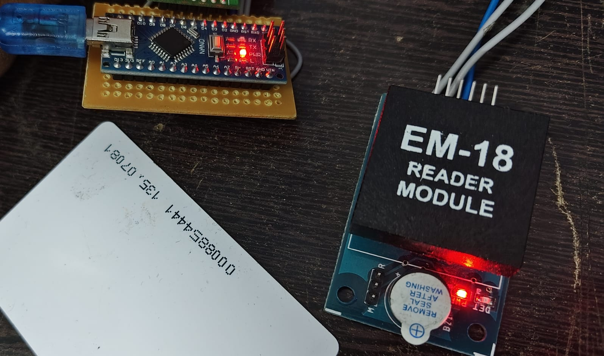
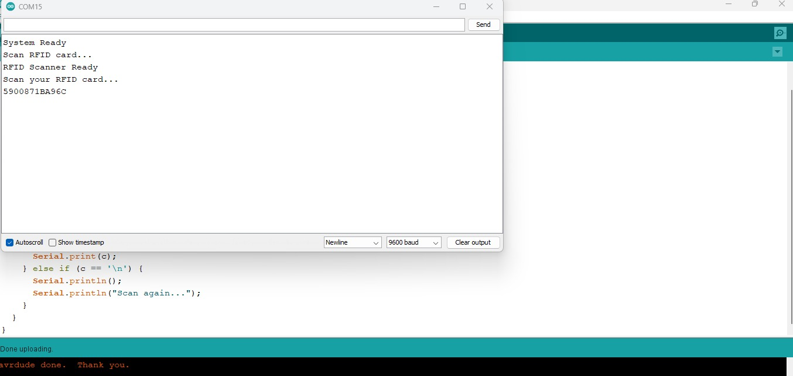

# Arduino Nano EM-18 RFID Scanner

## 📌 Project Overview

This project uses an Arduino Nano and EM-18 RFID reader module to scan RFID cards and read their unique IDs. The scanned data is displayed on the Arduino IDE Serial Monitor using SoftwareSerial communication at 9600 baud.

## 🛠️ Components Required

* Arduino Nano
* EM-18 RFID Reader Module
* RFID Card or Tag
* Jumper Wires
* USB Cable

## 🔌 Circuit Connections

| EM-18 RFID Reader | Arduino Nano |
| ----------------- | ------------ |
| TX                | D2 (RX)      |
| VCC               | 5V           |
| GND               | GND          |

**Note:** D3 is configured as the SoftwareSerial TX pin but is not physically connected.

## 📷 Circuit Diagram

## 💻 Software Requirements

* Arduino IDE
* SoftwareSerial Library

## ⚙️ Working Principle

1. The EM-18 RFID reader detects an RFID card or tag.
2. The reader transmits the card ID through serial communication.
3. Arduino Nano receives the data using SoftwareSerial on pin D2.
4. The scanned RFID ID is displayed on the Serial Monitor at 9600 baud.
5. The system is ready to scan the next card.

## 📟 Output

## 🚀 Applications

* RFID-based identification systems
* Access control prototypes
* RFID attendance systems
* RFID card monitoring

## ✅ Conclusion

This project demonstrates RFID card identification using Arduino Nano and the EM-18 RFID reader, providing a practical introduction to RFID technology and UART serial communication.
